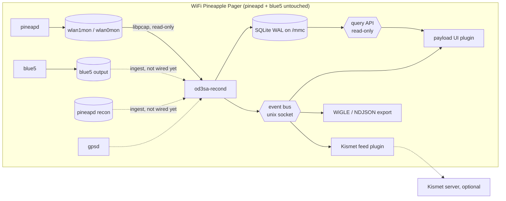

# od3sa-recon

A from-scratch, **passive, listen-only** WiFi recon package for the Hak5 WiFi
Pineapple Pager (OpenWrt 24.10.1, `mipsel_24kc`).

`od3sa-recond` reads the monitor interfaces that the Pager's own `pineapd`
already runs, without stopping it or changing its channel. Metadata is
stored in SQLite on the SD card, and **plugins** get the data through an
event bus and a read-only query API. WiGLE, NDJSON and the rest are
optional output plugins.

A read-only adapter for `blue5`'s Bluetooth output is written and tested,
but it is **not wired into the daemon yet** — the adapter's format is still
being confirmed against a real device. The diagram below shows it dashed
for that reason.

## What it does, and what it will never do

- It **opens a monitor interface for reading** and nothing else. It never
  changes a channel, a mode, or whether an interface is up, and it never
  brings one up or down.
- It **never transmits**. The capture crate does not even declare libpcap's
  transmit functions, so there is no call site to review — that holds
  whatever the toolchain does. The build additionally strips the transmit
  symbols out of the linked archive where the target's `objcopy` is
  available, so the shipped binary usually has no transmit entry point at
  all.
- It **never touches `pineapd` or `blue5`.** It reads what they have already
  written.
- It **never stores a payload.** No frame body and no EAPOL body is kept,
  and the database has nowhere to put one.
- It **never writes to a radio** and never opens one for anything but
  reading.

These are structural properties, not promises. The plugin API has no call
that touches a radio, and `cargo test` includes a test that fails if the
word `pcap_inject` or `pcap_sendpacket` ever appears in the capture crate.



## Installing it on the Pager

The daemon, its database, its configuration and its plugins live on the **SD
card**, under `/mmc/od3sa-recon` — the overlay is 15 MB and a firmware update
wipes it, while `/mmc` survives. Only the init script goes on the overlay,
and `reinstall.sh` puts it back afterwards.

**The ipk**, which is the whole thing in one file. Download it from the
[releases page](https://github.com/od3sa/od3sa-recon/releases) and:

```sh
scp od3sa-recon_<version>_mipsel_24kc.ipk root@172.16.52.1:/tmp/
ssh root@172.16.52.1 'opkg install /tmp/od3sa-recon_<version>_mipsel_24kc.ipk'
```

`172.16.52.1` is the address the Pager gives its USB network interface, and
it is the same on every device.

The daemon is started by the init script, and the configuration is
`/mmc/od3sa-recon/config.toml`.

**After a firmware update**, the overlay has been wiped and the init script
with it. Put it back:

```sh
ssh root@172.16.52.1 '/mmc/od3sa-recon/reinstall.sh'
```

**Or without the package**, for a test on the device:

```sh
# build the daemon for the device: static, soft-float, O32, MIPS32r2
build/build-mipsel.sh
scp target/mipsel-unknown-linux-musl/release/od3sa-recond root@172.16.52.1:/mmc/od3sa-recon/
ssh root@172.16.52.1 '/mmc/od3sa-recon/od3sa-recond --dry-run --interface wlan1mon --seconds 10'
```

The binary is **fully static**: it needs no libc, no libpcap and no SQLite on
the device, and no interpreter.

**Running the plugins.** A plugin is started by the host, which gives it the
socket and a token of its own:

```sh
# on the device, with the daemon running
export OD3SA_QUERY=/tmp/od3sa-recon/query.sock
export OD3SA_TOKEN=...
/mmc/od3sa-recon/plugins/ndjson-export/bin/ndjson-export /tmp/devices.ndjson devices
```

The payload the Pager's screen shows is `plugins/pager-ui/pager-ui.sh`: it
calls the plugin's binary and hands the output to `logger`.

## Status

Everything that does not need the device is done: the parsers, the capture
path, the storage, the query API, the event bus, the gpsd client, the alert
rules, the plugin host, the collector mode, the package and five plugins.

**What is left needs the device, or a fact only the owner has:** the pineapd
and blue5 output formats, the ten-minute passive test on the Pager, the
one-hour soak, and the pineapd ingest adapter that waits on the first of
those. Nothing that has not been run on a Pager has been claimed to work on
one.

## Responsible use

This tool observes radio metadata belonging to other people and other
networks. Only run it on equipment you own or on a network where you have
the owner's permission to do so, and follow the law where you are.

The database holds identifiers of networks and devices that are not yours.
Treat it as the sensitive material it is: keep it on the SD card, do not
publish it, and delete it when you are done with it.

The tool is defensive and for awareness. It is passive by construction and
cannot transmit, but nothing here is an authorisation to observe a network
that is not yours.

## Layout

| Path | Purpose |
|---|---|
| `Cargo.toml` | Cargo workspace (crates below) |
| `CHANGELOG.md` | What each release changed |
| `SECURITY.md` | How to report a vulnerability |
| `CONTRIBUTING.md` | How to build, test and propose a change |
| `deny.toml` | The dependency licence policy, enforced in CI |
| `crates/od3sa-parse` | Metadata-only radiotap / 802.11 parsers |
| `crates/od3sa-capture` | The libpcap binding — reading only |
| `crates/od3sa-store` | The SQLite schema, the aggregator and the batched writer |
| `crates/od3sa-events` | The NDJSON event bus |
| `crates/od3sa-gps` | The gpsd client |
| `crates/od3sa-alerts` | The awareness rules |
| `crates/od3sa-plugin` | The plugin host: manifests, capabilities, supervision |
| `crates/od3sa-plugins` | The plugins: pager-ui, ndjson-export, wigle-export, kismet-feed, pcapng-meta |
| `crates/od3sa-collector` | The collector: capture, aggregate, write, publish |
| `crates/od3sa-ingest` | The read-only ingest adapters |
| `crates/od3sa-fixtures` | The synthetic frame builders, for the tests |
| `crates/od3sa-recond` | The `od3sa-recond` daemon binary |
| `plugins/` | The plugin manifests |
| `build/` | `build-mipsel.sh` (the device build), `build-ipk.sh` (the package) |
| `docs/DESIGN.md` | Architecture |
| `docs/SCHEMA.md` | The SQLite schema |
| `docs/PLUGINS.md` | Plugin system, manifest, lifecycle |
| `docs/PACKAGING.md` | How the package is built and what it contains |
| `docs/api/` | Event and query API schemas |
| `docs/*-API.md` | The contracts each crate was written against |
| `docs/device-checks.md`, `scripts/device-checks.sh` | Read-only device checks |
| `docs/-device-test.md` | The on-device passive test, step by step |

## Building it

On an x86-64 Linux machine, or in CI:

```sh
build/build-mipsel.sh    # the daemon and the plugins, for the device
build/build-ipk.sh       # the package
```

The cross compiler is the OpenWrt SDK's own, so the binary matches the
firmware the Pager runs. It is **soft-float**, because the device's CPU has
no FPU.

`mipsel-unknown-linux-musl` is a Tier 3 target with no prebuilt standard
library, so the build uses a pinned nightly with `-Zbuild-std`. The SDK is
fetched if it is not already on the machine.

**The package is built on every merge.** The CI cross-builds the daemon and
the plugins for the device, assembles the ipk, checks it, and uploads it as
an artifact — so a change that breaks the packaging fails in the pull
request rather than at the next release.

**Releasing.** A tag of the form `v<version>` does the same thing in CI and
publishes the result: the ipk, the daemon binary on its own, and a checksum
of both. The tag's version has to match the workspace's, so a release can
never carry a package that disagrees with the source it was built from. The
package is assembled with the SDK's own `ipkg-build`; the SDK is fetched if
it is not already there.

## Licence

MIT — see [LICENSE](LICENSE). Copyright (c) 2026 Yakov Khalinsky.

The dependencies are MIT-compatible, and [`deny.toml`](deny.toml) enforces
that in CI: a dependency outside the allow list fails the build rather than
merging quietly.

## Contributing and security

See [CONTRIBUTING.md](CONTRIBUTING.md) for how to build, test and propose a
change, and [SECURITY.md](SECURITY.md) for how to report a vulnerability.
